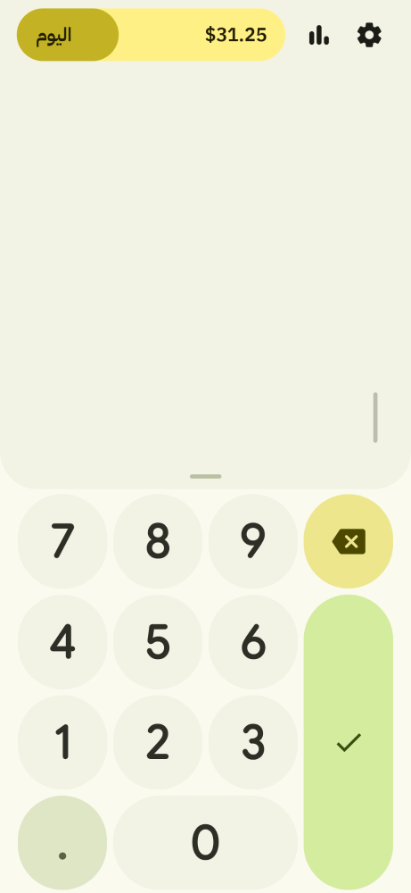
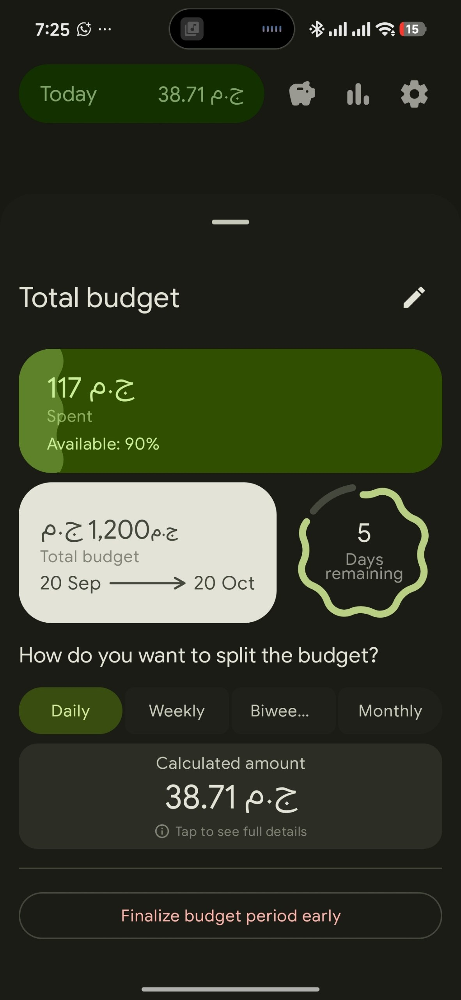
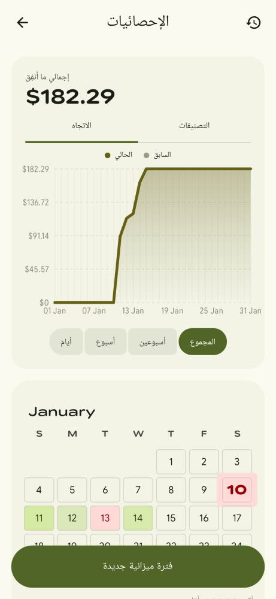
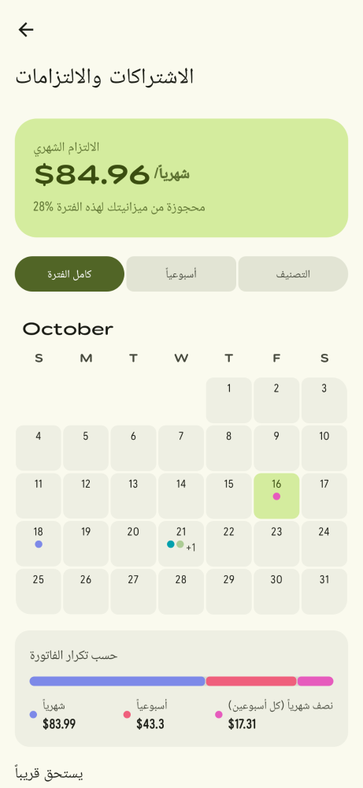
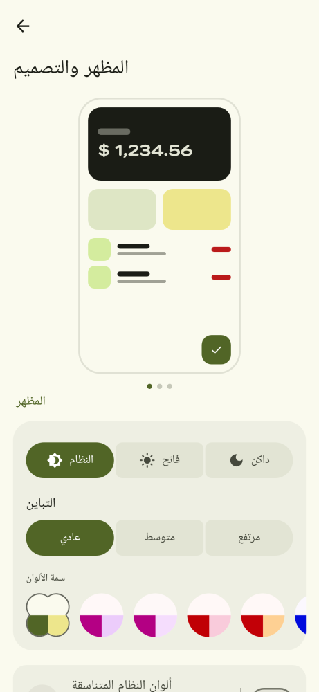
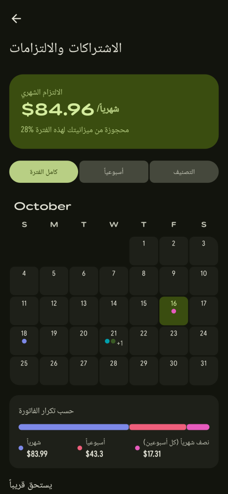
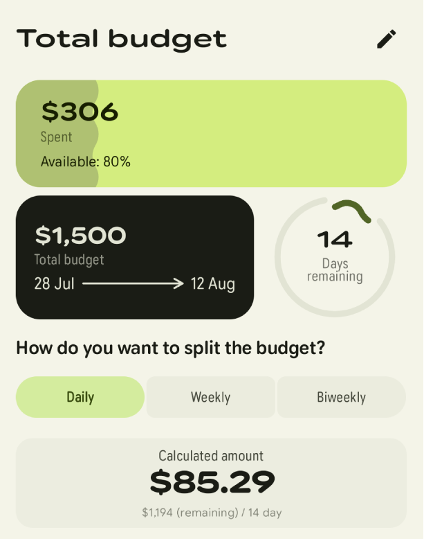
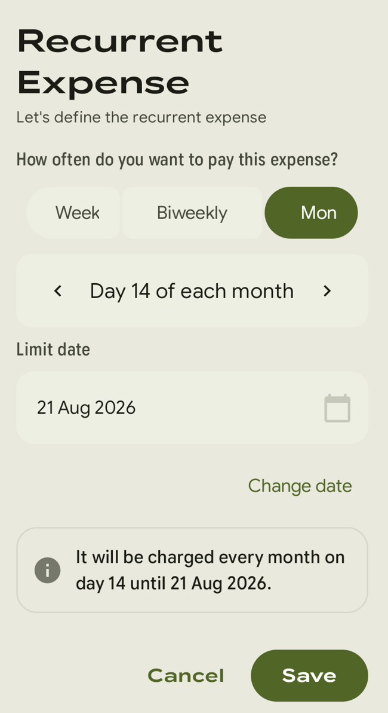
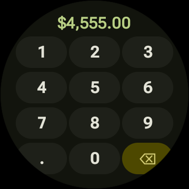

<p align="center">
  
</p>

# Wafeer - Simple, private, offline budget manager

<p align="center">
  <strong>Wafeer</strong> is an easy to use, offline-first personal budget and expense tracking app for Android and Wear OS.<br/>
  Register expenses instantly using a calculator numpad, organize flexible budget cycles, track recurring bills, and save towards your goals.
</p>

<div align="center">
  <h4>
    <a href="#features">Features</a>
    <span> &bull; </span>
    <a href="PROJECT_OVERVIEW.md">Project Overview</a>
    <span> &bull; </span>
    <a href="https://github.com/biZenX/Wafeer/issues/new?template=1_bug_report.yml">Report Bug</a>
    <span> &bull; </span>
    <a href="https://github.com/biZenX/Wafeer/issues/new?template=2_feature_request.yml">Request a Feature</a>
  </h4>
</div>

<table align="center">
  <tr>
    <td align="center">
      <a href="https://github.com/biZenX/Wafeer/releases/latest">
        
      </a>
    </td>
    <td align="center">
      <a href="https://play.google.com/store/apps/details?id=com.wafeer.app">
        
      </a>
    </td>
  </tr>
</table>

<p align="center">
  <a href="https://github.com/biZenX/Wafeer/releases/latest"></a>
  
  
  
</p>

<table align="center">
  <tr>
    <td></td>
    <td></td>
    <td></td>
  </tr>
  <tr>
    <td></td>
    <td></td>
    <td></td>
  </tr>
</table>

---

## Features

| Feature | Description |
|:---|:---|
| **Save, Edit & Calculate on the Fly** <br/> Log expenses in seconds using a familiar calculator-style numpad. No complex multi-step forms — tap the amount and save. Swipe up to reveal math operators and make calculations directly before logging. |  |
| **Smart Budget Periods** <br/> Configure your budget cycles to match your real cashflow. Choose between Daily, Weekly, Bi-weekly, or Monthly periods with automatic calculation of daily spending limits and rollover surplus. |  |
| **Recurring Expenses & Subscriptions** <br/> Track recurring subscriptions, bills, and credit card payments. Set advance reminders and let the app automatically deduct scheduled payments on due dates. |  |
| **Smart Savings Tools** <br/> Built-in behavioral tools to curb impulse spending: a 48-Hour Wishlist Filter with total money saved counter, an Affordability Simulator to preview purchase impacts, a Micro-Goal Jar, and a Guilt-Free Fun Fund. |  |
| **Spending Analytics & Insights** <br/> Group expenses by date, category, and payment method. Visual charts and breakdown metrics help you identify spending habits and spot where you can save. |  |
| **100% Offline & Private** <br/> All financial data stays strictly on your device in a local encrypted database. No user accounts, no cloud sync, and zero third-party analytics. The Google Play edition contains zero internet permissions. |  |
| **Wear OS Companion App** <br/> Log expenses and check remaining balance directly from your smartwatch. Full numpad interface optimized for circular and square displays, with local sync to the phone app. |  |

---

## Building from Source

### Prerequisites
- Android Studio Ladybug (2024.2.1+) or newer
- JDK 17 or JDK 21
- Android SDK API Level 35

### Commands
```bash
# Clone the repository
git clone https://github.com/biZenX/Wafeer.git
cd Wafeer

# Build FOSS Debug APK
./gradlew :app:assembleFossDebug

# Build Wear OS APK
./gradlew :wear:assembleDebug

# Run static analysis and unit tests
./gradlew detekt :app:testFossDebugUnitTest :app:testWearDebugUnitTest
```

The compiled APK will be at:
`app/build/outputs/apk/foss/debug/app-foss-debug.apk`

---

## Contributing

Contributions are welcome! Please check our [Contributing Guidelines](CONTRIBUTING.md) and [Code of Conduct](.github/CODE_OF_CONDUCT.md).

To report bugs or request features, use our [Issue Templates](https://github.com/biZenX/Wafeer/issues/new/choose).

---

## Credits & License

- **Wafeer**: Maintained by **Abdelrahman Karim ([@biZenX](https://github.com/biZenX))**.
- **Original Architecture**: Based on **[Minus](https://github.com/isaacsa51/Minus)** by **[Isaac Serrano (@isaacsa51)](https://github.com/isaacsa51)**.
- **Typography**: Native support for **Thmanyah** and **IBM Plex Sans Arabic** fonts.

Licensed under the **[Apache License 2.0](LICENSE)**. See [LICENSE.md](LICENSE.md) for full terms.

<div align="center">
  <p>Made with &hearts; by <a href="https://github.com/biZenX">Abdelrahman Karim</a></p>
</div>
